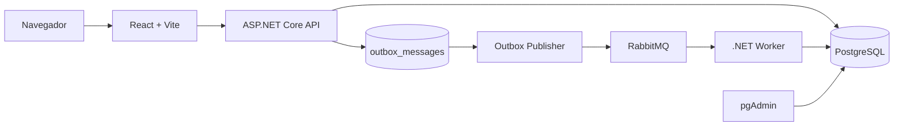

# TMB — Gestão de Pedidos

Aplicação desenvolvida para o desafio técnico da TMB. Permite criar pedidos, consultar detalhes e acompanhar o processamento assíncrono por meio de uma API .NET, RabbitMQ, Worker .NET e frontend React.

Fluxo do pedido:

```text
Pending → Processing → Completed
```

## Funcionalidades

- Criar, listar e consultar pedidos por ID;
- Histórico de alterações de status;
- Processamento assíncrono com Worker;
- RabbitMQ com Outbox Pattern;
- PostgreSQL com Entity Framework Core;
- Frontend React com polling a cada três segundos;
- Modal de detalhes e notificações de status;
- Migrations automáticas;
- Health check da API;
- Ambiente completo com Docker Compose;
- Administração do banco pelo pgAdmin.

## Tecnologias

- .NET 8 / ASP.NET Core Web API;
- .NET Worker Service;
- Entity Framework Core;
- PostgreSQL 16;
- RabbitMQ 3;
- React, TypeScript e Vite;
- Docker e Docker Compose;
- pgAdmin.

## Arquitetura



O fluxo de mensageria é:

```text
Frontend
   ↓
API
   ↓
Order + History + OutboxMessage
   ↓
Outbox Publisher
   ↓
RabbitMQ
   ↓
Worker
   ↓
Processing → Completed
```

A API não publica diretamente no RabbitMQ. Ela salva o pedido, o histórico inicial e o evento na tabela `outbox_messages` dentro da mesma transação. O `OutboxPublisher` publica os eventos pendentes e marca `ProcessedOnUtc` somente após a publicação.

Se o RabbitMQ estiver indisponível, o pedido permanece salvo e o evento fica pendente para nova tentativa.

## Estrutura

```text
TMB-Gestão de Pedidos/
├── Backend/
│   ├── tmb.pedidos.api/
│   ├── tmb.pedidos.Domain/
│   ├── tmb.pedidos.Infrastructure/
│   └── tmb.pedidos.Worker/
├── Frontend/
│   └── tmb-pedidos-web/
├── docker-compose.yml
├── .env.example
├── .gitignore
└── README.md
```

## Pré-requisitos

- Docker Desktop instalado e em execução;
- Docker Compose v2;
- Navegador web.

Verifique:

```powershell
docker --version
docker compose version
```

## Configuração e segurança

As credenciais não devem ser armazenadas no código-fonte. O projeto utiliza `.env` local e `.env.example` como modelo.

Crie o `.env`:

```powershell
Copy-Item .env.example .env
```

Exemplo de `.env.example`:

```env
POSTGRES_DB=schema
POSTGRES_USER=user
POSTGRES_PASSWORD=change-me
POSTGRES_PORT=5432

RABBITMQ_USER=user
RABBITMQ_PASSWORD=change-me
RABBITMQ_PORT=5672
RABBITMQ_MANAGEMENT_PORT=15672

API_PORT=8080
FRONTEND_PORT=5173

PGADMIN_PORT=5050
PGADMIN_EMAIL=admin@example.com
PGADMIN_PASSWORD=change-me
```

O `.env` deve estar no `.gitignore`:

```gitignore
.env
.env.*
!.env.example

**/bin/
**/obj/
**/node_modules/
**/dist/
```

Variáveis `VITE_*` ficam visíveis no navegador. Nunca coloque senhas, tokens ou chaves de API no frontend.

Em produção, recomenda-se utilizar Docker Secrets, Azure Key Vault, Azure App Service/Container Apps Secret Variables ou secrets do pipeline, como GitHub Actions Secrets.

## Execução com Docker Compose

Execute na raiz do projeto:

```powershell
docker compose config
docker compose up --build -d
docker compose ps -a
```

Containers esperados:

```text
tmb-api        Up (healthy)
tmb-frontend   Up
tmb-pgadmin    Up
tmb-postgres   Up (healthy)
tmb-rabbitmq   Up (healthy)
tmb-worker     Up
```

Para parar sem apagar os dados:

```powershell
docker compose down
```

Para apagar também os volumes e recriar o banco do zero:

```powershell
docker compose down -v
```

> Use `down -v` somente quando realmente desejar apagar os dados persistidos.

## URLs

| Serviço | URL |
|---|---|
| Frontend | http://localhost:5173 |
| API | http://localhost:8080 |
| Swagger | http://localhost:8080/swagger |
| Health check | http://localhost:8080/health |
| RabbitMQ Management | http://localhost:15672 |
| pgAdmin | http://localhost:5050 |

As credenciais locais do RabbitMQ e pgAdmin são as configuradas no `.env`.

## API

Rota base:

```text
/api/v1/Order
```

Criar pedido:

```http
POST /api/v1/Order
```

```json
{
  "customer": "João da Silva",
  "product": "Notebook",
  "value": 3500.00
}
```

Listar pedidos:

```http
GET /api/v1/Order
```

Consultar por ID:

```http
GET /api/v1/Order/{id}
```

Health check:

```http
GET /health
```

## Mensageria e Outbox

Configuração utilizada:

```text
Exchange: orders.exchange
Queue: orders.order-created
Routing key: order.created
```

Payload do evento:

```json
{
  "orderId": "00000000-0000-0000-0000-000000000000"
}
```

O fluxo é:

```text
1. API cria o pedido;
2. API salva pedido, histórico e Outbox na mesma transação;
3. Outbox Publisher busca mensagens pendentes;
4. RabbitMqPublisher publica o evento;
5. Outbox é marcado como processado;
6. Worker consome a mensagem;
7. Worker atualiza Processing e Completed;
8. Histórico é persistido.
```

A tabela `outbox_messages` registra:

```text
ProcessedOnUtc
Attempts
LastError
NextAttemptOnUtc
```

Consulta para acompanhar o Outbox:

```sql
SELECT
    "Id",
    "Type",
    "ProcessedOnUtc",
    "Attempts",
    "LastError",
    "NextAttemptOnUtc"
FROM outbox_messages
ORDER BY "OccurredOnUtc" DESC;
```

Eventos com `ProcessedOnUtc = NULL` ainda estão pendentes.

## Frontend e polling

Enquanto houver pedidos com status `Pending` ou `Processing`, o frontend consulta a API a cada três segundos:

```http
GET /api/v1/Order
```

A modal de detalhes também atualiza o pedido selecionado por:

```http
GET /api/v1/Order/{id}
```

O polling consulta a API; a notificação informa ao usuário quando o status muda.

## Banco de dados

O PostgreSQL armazena:

- pedidos;
- status atual;
- histórico de status;
- eventos pendentes do Outbox.

A API aplica as migrations na inicialização.

Para conectar pelo pgAdmin:

```text
Host: postgres
Porta: 5432
Database: tmb_pedidos
Usuário: valor do POSTGRES_USER
Senha: valor do POSTGRES_PASSWORD
```

Dentro do pgAdmin, use `postgres` como host, não `localhost`.

## Testes

Execute os testes unitários com xUnit:

```powershell
dotnet test ".\Backend\tmb.pedidos.api\tmb.pedidos.api.sln" --verbosity normal
```

Os testes cobrem:

- criação da entidade `Order`;
- status inicial `Pending`;
- histórico;
- transições `Pending → Processing → Completed`;
- transições inválidas;
- processamento do Worker;
- pedido inexistente;
- idempotência para pedidos `Processing` e `Completed`.

Teste manual do Outbox:

```powershell
docker compose stop rabbitmq
```

Crie um pedido e confirme que ele foi salvo com o evento pendente. Depois reative o RabbitMQ:

```powershell
docker compose start rabbitmq
docker compose logs -f worker
```

O `OutboxPublisher` deverá publicar o evento pendente e o Worker deverá concluir o pedido.

## Logs

```powershell
docker compose logs -f
```

```powershell
docker compose logs -f api
docker compose logs -f worker
docker compose logs -f rabbitmq
```

Status dos containers:

```powershell
docker compose ps -a
```

## Execução local sem Docker

PostgreSQL e RabbitMQ precisam estar disponíveis localmente.

API:

```powershell
dotnet run --project ".\Backend\tmb.pedidos.api\tmb.pedidos.API.csproj"
```

Worker:

```powershell
dotnet run --project ".\Backend\tmb.pedidos.Worker\tmb.pedidos.Worker.csproj"
```

Frontend:

```powershell
cd ".\Frontend\tmb-pedidos-web"
npm install
npm run dev
```

## Melhorias futuras

- SignalR com polling como fallback;
- Testes de integração com containers descartáveis;
- Tracing distribuído e `CorrelationId`;
- Dead-letter queue e políticas avançadas de retry;
- Paginação e filtros;
- Autenticação e autorização;
- Métricas e analytics;
- Integração com Azure Key Vault em produção.

## Licença

Projeto desenvolvido para fins de avaliação técnica.
