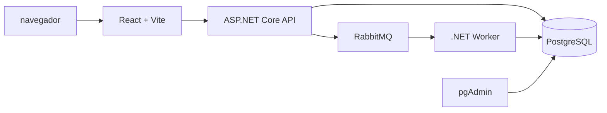

# TMB — Gestão de Pedidos

Aplicação desenvolvida para o desafio técnico da TMB. O sistema permite criar pedidos, consultar detalhes e acompanhar o processamento assíncrono por meio de uma API .NET, RabbitMQ, um Worker e uma aplicação React.

---
## Funcionalidades

- Criação de pedidos;
- Listagem de pedidos;
- Consulta por ID;
- Histórico de alterações de status;
- Processamento assíncrono com Worker;
- Comunicação por RabbitMQ;
- Persistência em PostgreSQL;
- Atualização automática no frontend por polling;
- Modal de detalhes e notificações de alteração de status;
- Migrations automáticas;
- Health check da API;
- Ambiente completo executável com Docker Compose;
- Administração do banco com pgAdmin.

---

## Tecnologias

- .NET 8 e ASP.NET Core Web API;
- .NET Worker Service;
- Entity Framework Core;
- PostgreSQL 16;
- RabbitMQ 3;
- React, TypeScript e Vite;
- Nginx;
- Docker e Docker Compose;
- pgAdmin.

---

## Arquitetura



O fluxo de processamento é:

```text
Frontend → API → PostgreSQL
              ↓
          RabbitMQ → Worker → PostgreSQL
```

Dentro do Docker Compose, os serviços se comunicam pelos nomes:

```text
postgres
rabbitmq
api
frontend
pgadmin
```

---

## Estrutura do projeto

```text
TMB-Gestão de Pedidos/
├── Backend/
│   ├── tmb.pedidos.api/
│   ├── tmb.pedidos.Domain/
│   ├── tmb.pedidos.Infrastructure/
│   └── tmb.pedidos.Worker/
├── Frontend/
│   └── tmb-pedidos-web/
├── docker-compose.yml
├── .env.example
├── .gitignore
└── README.md
```

Os projetos possuem Dockerfiles próprios para a API, o Worker e o frontend.

---

## Pré-requisitos

- Docker Desktop instalado e em execução;
- Docker Compose v2;
- Navegador web.

Verifique a instalação:

```powershell
docker --version
docker compose version
```

---

## Configuração de ambiente e segurança

As credenciais não devem ser armazenadas diretamente no código-fonte, no `docker-compose.yml`, no frontend ou no README.

O projeto utiliza o arquivo `.env` para configuração local. O arquivo `.env.example` contém apenas o modelo das variáveis e pode ser versionado.

Crie o `.env` na raiz do projeto:

```powershell
Copy-Item .env.example .env
```

Exemplo de configuração local:

```env
# PostgreSQL
POSTGRES_DB=schema
POSTGRES_USER=user
POSTGRES_PASSWORD=pass
POSTGRES_PORT=5432

# RabbitMQ
RABBITMQ_USER=user
RABBITMQ_PASSWORD=pass
RABBITMQ_PORT=5672
RABBITMQ_MANAGEMENT_PORT=15672

# API e frontend
API_PORT=8080
FRONTEND_PORT=5173

# pgAdmin
PGADMIN_PORT=5050
PGADMIN_EMAIL=admin@example.com
PGADMIN_PASSWORD=admin123
```

O arquivo `.env` deve estar no `.gitignore`:

```gitignore
.env
.env.*
!.env.example
```

Também não devem ser versionados:

```text
bin/
obj/
node_modules/
dist/
```

Variáveis com o prefixo `VITE_` são incorporadas ao JavaScript e ficam visíveis no navegador. Portanto, nunca coloque no frontend:

```env
VITE_DATABASE_PASSWORD=...
VITE_RABBITMQ_PASSWORD=...
VITE_API_KEY=...
```

### Produção e Azure

Para desenvolvimento local, o `.env` é suficiente. Em produção, recomenda-se utilizar um gerenciador de segredos, evitando salvar senhas no servidor, no repositório ou em arquivos de configuração.

Algumas alternativas são:

- **Docker Secrets**, para disponibilizar credenciais como arquivos em `/run/secrets/`;
- **Azure Key Vault**, para armazenar e recuperar segredos com identidade gerenciada;
- **Azure Container Apps, Azure App Service ou Azure DevOps**, utilizando Secret Variables/Application Settings;
- GitHub Actions Secrets ou outro gerenciador de secrets do pipeline.

Exemplos de informações que devem ser armazenadas como secrets:

```text
POSTGRES_PASSWORD
RABBITMQ_PASSWORD
PGADMIN_PASSWORD
Connection strings
API keys
JWT signing keys
```

O `.env` utilizado localmente não deve ser tratado como solução definitiva de produção. Em um ambiente Azure, uma alternativa adequada seria armazenar os valores no Azure Key Vault e injetá-los na aplicação por meio de configurações do serviço ou de identidade gerenciada.

---

## Execução com Docker Compose

Execute os comandos na raiz do projeto, onde está o `docker-compose.yml`.

Valide a configuração:

```powershell
docker compose config
```

Construa e inicie todos os serviços:

```powershell
docker compose up --build -d
```

O resultado esperado é semelhante a:

```text
tmb-api        Up (healthy)
tmb-frontend   Up
tmb-pgadmin    Up
tmb-postgres   Up (healthy)
tmb-rabbitmq   Up (healthy)
tmb-worker     Up
```

Para parar o ambiente:

```powershell
docker compose down
```

Para remover também os volumes e apagar os dados persistidos:

```powershell
docker compose down -v
```

> Use `docker compose down -v` somente quando desejar recriar o banco do zero.

---

## URLs dos serviços

| Serviço | URL |
|---|---|
| Frontend | http://localhost:5173 |
| API | http://localhost:8080 |
| Swagger | http://localhost:8080/swagger |
| Health check | http://localhost:8080/health |
| RabbitMQ Management | http://localhost:15672 |
| pgAdmin | http://localhost:5050 |

## Fluxo de processamento

1. O usuário cria um pedido no frontend;
2. A API valida e salva o pedido com status `Pending`;
3. A API publica o evento de criação no RabbitMQ;
4. O Worker consome a mensagem;
5. O Worker altera o pedido para `Processing`;
6. O Worker registra a alteração no histórico;
7. Após o processamento, o Worker altera o pedido para `Completed`;
8. O frontend identifica as mudanças por polling e atualiza a interface.

O payload da mensagem contém o identificador do pedido:

```json
{
  "orderId": "00000000-0000-0000-0000-000000000000"
}
```

A configuração atual utiliza conceitos equivalentes a:

```text
Exchange: orders.exchange
Queue: orders.order-created
Routing key: order.created
```

---

## API

Rota base:

```text
/api/v1/Order
```

Criar pedido:

```http
POST /api/v1/Order
```

```json
{
  "customer": "João da Silva",
  "product": "Notebook",
  "value": 3500.00
}
```

Listar pedidos:

```http
GET /api/v1/Order
```

Consultar pedido por ID:

```http
GET /api/v1/Order/{id}
```

Health check:

```http
GET /health
```

---

## Frontend e polling

O frontend consulta a API a cada três segundos enquanto houver pedidos com status:

```text
Pending
Processing
```

A lista é consultada por:

```http
GET /api/v1/Order
```

Quando o usuário abre a modal de detalhes, o pedido selecionado pode ser atualizado por:

```http
GET /api/v1/Order/{id}
```

A diferença entre polling e notificação é:

```text
Polling:
consulta periodicamente a API.

Notificação:
informa ao usuário que o status retornado mudou.
```

Quando todos os pedidos estão finalizados, as consultas automáticas são interrompidas. O usuário ainda pode atualizar a lista manualmente.

---

## Banco de dados e migrations

O PostgreSQL armazena:

- Dados dos pedidos;
- Status atual;
- Data de criação;
- Histórico de status.

A API executa as migrations na inicialização, depois que o PostgreSQL está saudável.

O volume utilizado pelo banco é:

```text
tmb-gestodepedidos_postgres_data
```

Para conectar pelo pgAdmin, use:

```text
Host: postgres
Porta: 5432
Database: tmb_pedidos
Usuário: postgres
Senha: postgres
```

Dentro do pgAdmin, o host deve ser `postgres`, e não `localhost`, pois o pgAdmin também é executado dentro da rede Docker.

---

## Execução local sem Docker

Para executar localmente, PostgreSQL e RabbitMQ precisam estar disponíveis no computador.

API:

```powershell
dotnet run --project ".\Backend\tmb.pedidos.api\tmb.pedidos.API.csproj"
```

Worker:

```powershell
dotnet run --project ".\Backend\tmb.pedidos.Worker\tmb.pedidos.Worker.csproj"
```

Frontend:

```powershell
cd ".\Frontend\tmb-pedidos-web"
npm install
npm run dev
```

Para compilar o backend:

```powershell
dotnet restore ".\Backend\tmb.pedidos.sln"
dotnet build ".\Backend\tmb.pedidos.sln"
```

Para compilar o frontend:

```powershell
cd ".\Frontend\tmb-pedidos-web"
npm run build
```

---

## Decisões técnicas

- A API e o Worker foram separados para manter o processamento assíncrono fora do ciclo da requisição HTTP;
- PostgreSQL foi utilizado para persistir pedidos e histórico;
- RabbitMQ foi utilizado para desacoplar a criação do pedido do processamento;
- Polling foi utilizado no frontend por ser simples, confiável e suficiente para a atualização de status;
- Docker Compose permite iniciar o ambiente completo com um único comando;
- Migrations automáticas facilitam a execução em um ambiente novo.

---

## Limitações e evoluções futuras

Possíveis evoluções:

- Outbox Pattern para garantir publicação transacional;
- SignalR com polling como fallback;
- Testes unitários e testes de integração com containers descartáveis;
- Tracing distribuído e `CorrelationId`;
- Retry e dead-letter queue no RabbitMQ;
- Paginação e filtros;
- Autenticação e autorização;
- Métricas e observabilidade;
- Integração com Azure Key Vault em produção;
- Módulo de analytics e uso de LLM.

---

## Licença

Projeto desenvolvido para fins de avaliação técnica.
